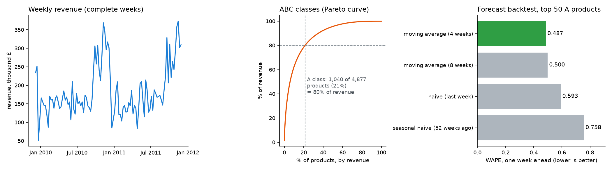
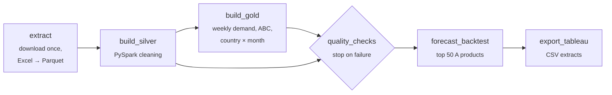

# retail-demand-pipeline

[](https://github.com/YusufErem/retail-demand-pipeline/actions/workflows/tests.yml)


**A weekly retail demand pipeline.** PySpark cleans a million real transactions, builds weekly demand per product
and ABC classes, stops when a data-quality check fails, backtests simple demand forecasts, and exports the tables
for a Tableau dashboard. An Airflow DAG runs the steps in order every week.



<sub>Drawn from the pipeline's CSV extracts by [`docs/make_figures.py`](docs/make_figures.py).</sub>

## Pipeline



| Layer | Contents |
|---|---|
| `data/raw` | the UCI workbook (both sheets, 2009–2011) as one Parquet file |
| `data/silver` | clean transactions with revenue, week and month, partitioned by month |
| `data/gold` | `weekly_demand` (product × week: units, revenue, orders, complete-week flag), `abc_classes`, `country_month`, backtest results |
| `tableau/` | seven small CSV extracts for the dashboard |

## Results of a full run

| Step | Result |
|---|---|
| Cleaning | 1,067,371 raw rows → 1,003,214 clean. Removed in order: 34,335 exact duplicates, 19,104 cancellation lines, 3,393 non-positive quantities, 2,626 non-positive prices, 4,699 fee and adjustment codes (POST, DOT, M, BANK CHARGES…). Rows without a customer ID are kept: the sale is still demand. |
| ABC classes | 1,040 of 4,877 products (21%) bring 80% of revenue (A), the next 15% comes from 1,280 products (B), the last 5% from 2,557 (C). |
| Quality checks | 9 of 9 pass: no non-positive quantities or prices, no cancellations, no missing keys, only product codes, one row per product and week, weekly revenue equal to transaction revenue, all three classes present, cumulative share ending at 100%. |
| Forecast backtest | One week ahead for the 50 largest A products over the last 12 complete weeks (12 Sep – 28 Nov 2011), pooled WAPE: 4-week moving average **0.487**, 8-week moving average 0.500, last week 0.593, same week last year 0.758. |

The backtest weeks are the run-up to Christmas: demand climbs, so the moving averages under-forecast (bias −15% and
−22%), while last year's weeks over-forecast (+13%). A useful next model would add the yearly pattern to the recent
level instead of choosing one of them.

## Run it

Needs Python 3.11+ and Java 17+ (for Spark).

```bash
git clone https://github.com/YusufErem/retail-demand-pipeline.git && cd retail-demand-pipeline
python3 -m venv .venv && .venv/bin/pip install -e ".[dev]"
.venv/bin/python -m retail_pipeline.run        # about a minute; downloads the data (45 MB) on the first run
```

**With Airflow**

```bash
.venv/bin/pip install "apache-airflow==3.3.2" \
  --constraint https://raw.githubusercontent.com/apache/airflow/constraints-3.3.2/constraints-3.13.txt
export AIRFLOW_HOME=$PWD/.airflow AIRFLOW__CORE__DAGS_FOLDER=$PWD/dags AIRFLOW__CORE__LOAD_EXAMPLES=False
.venv/bin/airflow db migrate
.venv/bin/airflow dags test retail_demand_pipeline   # runs the six tasks once, in order
.venv/bin/airflow standalone                         # optional: the web UI on http://localhost:8080
```

(Use the constraints file that matches your Python version, e.g. `constraints-3.12.txt`.)

## Tableau dashboard

`tableau/` holds the extracts the dashboard reads: weekly totals, weekly demand of the top products, the ABC table,
revenue by country and month, and the backtest results. [`docs/TABLEAU.md`](docs/TABLEAU.md) lists the sheets and
how to rebuild the dashboard in Tableau Public.

## Design choices

- **Every cleaning rule is explicit and counted**, so the drop from raw to clean rows can be explained line by line.
- **Partial weeks are flagged, not dropped.** The first and last weeks are cut by the extract dates; the flag keeps
  them out of the forecast while the weekly table still reconciles exactly with the transactions.
- **Quality checks gate the run.** The backtest and the export only run after every check passes, so a broken table
  never reaches the dashboard.
- **Forecasts are scored the way they would be used:** rolling origin, one week ahead, only past weeks visible.
- **Light DAG file.** Spark and pandas are imported inside the tasks, so the scheduler parses the DAG quickly; tasks
  pass file paths, not data, between each other.

## Tests

```bash
.venv/bin/pytest
```

The tests build small tables whose right answer is known: one row of every kind the cleaning must drop, partial
weeks, revenue shares that land exactly on the ABC limits, broken tables the quality checks must catch, a seasonal
series where last year's week is exact, and the DAG's task order. They run on every push.

## Data

Chen, D. (2012). *Online Retail II* [Dataset]. UCI Machine Learning Repository.
[https://doi.org/10.24432/C5CG6D](https://doi.org/10.24432/C5CG6D). Licensed under
[CC BY 4.0](https://creativecommons.org/licenses/by/4.0/). The raw data is downloaded by the pipeline and not stored
in this repository; `tableau/` contains aggregated extracts derived from it.

## License

Code: MIT © 2026 Yusuf Ömer Erem.
